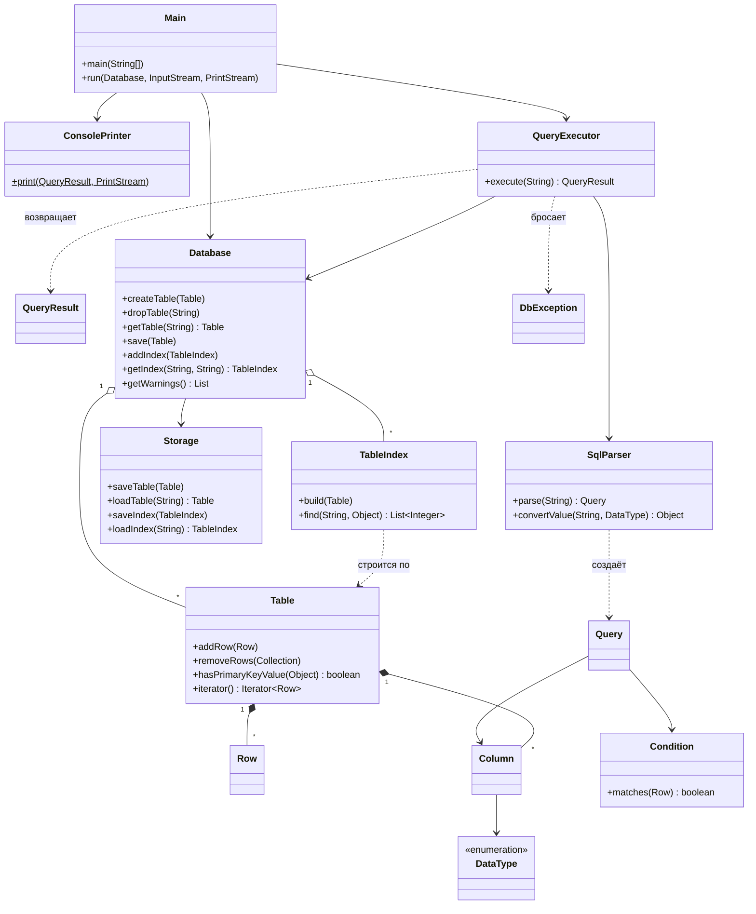
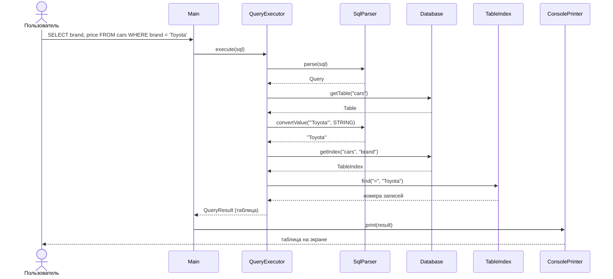
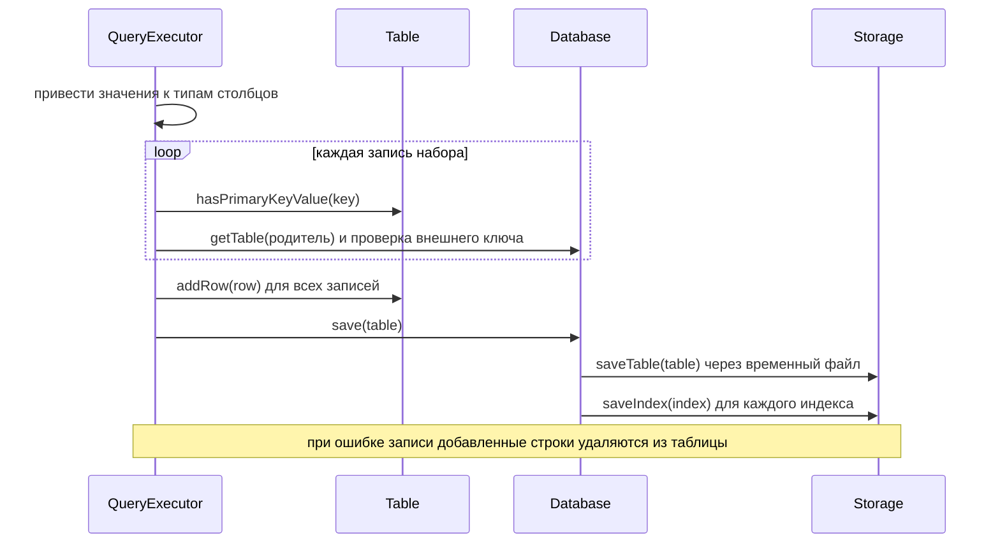

# Лабораторная работа 2. Упрощённая СУБД на Java

Консольная СУБД с SQL-подобным языком запросов. Данные хранятся в файлах на диске и загружаются при запуске. Есть первичные и внешние ключи, индексы и защита от аварийного завершения.

Предметная область: владельцы (`owners`) и автомобили (`cars`). Таблицы связаны внешним ключом `cars.owner_id → owners.id`.

## Возможности

| Требование | Реализация |
|---|---|
| Типы данных | `INT`, `DOUBLE`, `STRING`, `DATE` (`ГГГГ-ММ-ДД`), `BOOLEAN` (`TRUE`/`FALSE`), значение `NULL` |
| Две и более связанные таблицы | первичный ключ (`PRIMARY KEY`) и внешний ключ (`REFERENCES` или `FOREIGN KEY`) |
| `INSERT` | одна или несколько записей: `VALUES (...), (...)`, с проверкой уникальности ключа, типов и внешнего ключа; запрос атомарен, при ошибке в любой записи не добавляется ни одна |
| `SELECT` | `*` или список столбцов, `WHERE` с операторами `= != <> > < >= <=`, вывод таблицей |
| `UPDATE`, `DELETE` | по условию; изменение ключей проверяется (дубликаты, ссылки из других таблиц) |
| `CREATE TABLE`, `DROP TABLE` | `DROP` запрещён, пока на таблицу ссылается другая |
| `CREATE INDEX` | индекс на дереве (`TreeMap`), работает для `= > >= < <=`, сохраняется на диск и восстанавливается |
| Надёжность | атомарная запись файлов, очистка временных файлов, повреждённый индекс не мешает запуску |
| Обработка ошибок | любой некорректный ввод даёт сообщение, программа не падает |

Ограничения: в `WHERE` одно условие (без `AND`/`OR`), в `SET` один столбец, внешний ключ только один на таблицу и только на первичный ключ. Строки в `WHERE` сравниваются с учётом регистра, как в стандартном SQL.

## Архитектура

### Слои

```
Main ── ConsolePrinter          консольный интерфейс (единственное место ввода-вывода)
  │
QueryExecutor ── SqlParser      логика выполнения запросов, разбор SQL
  │
Database ── Storage             репозиторий и доступ к файлам (DAO)
  │
Table, Row, Column, TableIndex  модель данных (без ввода-вывода)
```

Классы модели (`Table`, `Row`, `Column`, `TableIndex`, `Condition`, `QueryResult`) ничего не читают с клавиатуры и ничего не печатают: они только хранят и обрабатывают данные. Вывод выполняют только `Main` и `ConsolePrinter`. Ошибки передаются исключением `DbException` с понятным сообщением.

### Диаграмма классов



### Диаграмма последовательности: `SELECT ... WHERE brand = 'Toyota'` с индексом



### Диаграмма последовательности: `INSERT` с проверками и сохранением



### Хранение и надёжность

- Таблицы лежат в `data/tables/<имя>.db`, индексы в `data/indexes/<имя>.idx` (сериализация Java). Каталог `data` создаётся в той папке, откуда запущена программа.
- Файл записывается во временный `*.tmp`, сбрасывается на диск (`fsync`) и атомарно переименовывается. После сбоя на диске остаётся либо старая, либо новая полная версия файла.
- При запуске удаляются недописанные `*.tmp`. Индекс при загрузке перестраивается по таблице, поэтому он не может разойтись с данными. Повреждённый файл пропускается с предупреждением.
- Если запись на диск не удалась, изменение в памяти откатывается.

## Результаты тестирования производительности

Запрос выполняется целиком (разбор, поиск, формирование результата) на таблице `cars(id, brand, price)`. Индексы: `idx_cars_id` и `idx_cars_brand`. Приведена медиана 21 запуска после прогрева. Среда: OpenJDK 21, облачная Linux-машина. На вашем компьютере абсолютные числа будут другими, а соотношение сохранится. Чтобы получить свои цифры: `java PerformanceTest`.

| Записей | Запрос | Найдено | Без индекса, мс | С индексом, мс | Ускорение |
|---:|---|---:|---:|---:|---:|
| 10 000 | `WHERE id = 5000` | 1 | 0.975 | 0.030 | 32× |
| 10 000 | `WHERE brand = 'Brand50'` | 100 | 1.807 | 0.045 | 40× |
| 10 000 | `WHERE id > 9900` | 99 | 0.981 | 0.078 | 13× |
| 100 000 | `WHERE id = 50000` | 1 | 2.939 | 0.015 | 198× |
| 100 000 | `WHERE brand = 'Brand50'` | 1000 | 3.736 | 0.168 | 22× |
| 100 000 | `WHERE id > 99900` | 99 | 3.756 | 0.043 | 87× |
| 500 000 | `WHERE id = 250000` | 1 | 31.640 | 0.009 | 3646× |
| 500 000 | `WHERE brand = 'Brand50'` | 5000 | 36.746 | 0.970 | 38× |
| 500 000 | `WHERE id > 499900` | 99 | 32.171 | 0.024 | 1330× |

Без индекса время растёт линейно с размером таблицы (полный перебор, O(n)). С индексом поиск идёт по дереву за O(log n) плюс размер результата, поэтому выигрыш тем больше, чем больше таблица и чем меньше найдено записей. Если запросу подходит больше записей (1 % таблицы для `brand`), основное время уходит на формирование результата, и выигрыш меньше.

## Инструкция пользователя

### Сборка и запуск

Нужна JDK 8 или новее.

```bash
javac -encoding UTF-8 *.java
java -Dfile.encoding=UTF-8 Main
```

В IntelliJ IDEA: открыть папку проекта, запустить класс `Main`. Если русский текст в консоли отображается неверно, добавьте в настройки запуска VM option `-Dfile.encoding=UTF-8`.

Команда `HELP` выводит справку, `EXIT` или конец ввода (Ctrl+D / Ctrl+Z) завершают работу. Запросы можно писать с `;` и без. Данные сохраняются автоматически после каждого изменения.

### Примеры команд

```sql
CREATE TABLE owners (id INT PRIMARY KEY, name STRING, birthDate DATE, active BOOLEAN);
CREATE TABLE cars (id INT PRIMARY KEY, brand STRING, price DOUBLE, owner_id INT REFERENCES owners(id));

INSERT INTO owners VALUES (1, 'Ivan', '2005-05-10', TRUE), (2, 'Olga', '2001-01-01', FALSE);
INSERT INTO cars VALUES (1, 'Toyota', 25000.0, 1);
INSERT INTO cars (id, brand) VALUES (2, 'BMW');

CREATE INDEX idx_cars_brand ON cars (brand);

SELECT * FROM cars;
SELECT brand, price FROM cars WHERE price > 20000;
UPDATE cars SET price = 30000 WHERE id = 2;
DELETE FROM cars WHERE brand = 'Toyota';

DROP TABLE cars;
```

Пример вывода:

```
> SELECT brand, price FROM cars WHERE brand = 'Toyota';
+--------+---------+
| brand  | price   |
+--------+---------+
| Toyota | 25000.0 |
+--------+---------+
Найдено записей: 1 (использован индекс idx_cars_brand)
```

Примеры ошибок (программа продолжает работу):

```
> INSERT INTO cars VALUES (3, 'Audi', abc, 1);
Ошибка: Запись 1, столбец price: Ожидалось число (DOUBLE), получено: abc
> DELETE FROM owners WHERE id = 1;
Ошибка: Запись с ключом 1 используется другой таблицей, удалять нельзя
```

### Правила записи значений

- Строки и даты в одинарных кавычках: `'Toyota'`, `'2005-05-10'`. Кавычка внутри строки удваивается: `'C''s'`. Типографские кавычки ‘ ’ тоже понимаются.
- Булевы значения: `TRUE` / `FALSE` без кавычек. Пустое значение: `NULL`.
- Ключевые слова и имена таблиц и столбцов можно писать в любом регистре.

### Тесты

```bash
java DbTests          # автотесты (ничего не пишут в каталог data)
java PerformanceTest  # замеры, как в таблице выше
```

`DbTests` проверяют CRUD, ограничения ключей, типы и некорректный ввод (буквы вместо чисел, пустые и обрезанные запросы, ввод до конца потока), совпадение результатов индекса и полного перебора, сохранение и восстановление после сбоя.

## Распределение обязанностей

### Виктория Зорина
- Логика выполнения запросов и работа с условиями (`QueryExecutor.java`, `Condition.java`)
- Модуль индексации и ускорения поиска (`TableIndex.java`)
- Тесты производительности и автотесты (`PerformanceTest.java`, `DbTests.java`)
- Связность строк и таблиц (`Row.java`)
- Проверка и исправление ошибок во всём проекте: валидация ввода и типов, проверки первичного и внешнего ключей, совместимость с Java 8
- Вынос ввода-вывода из классов данных (`QueryResult.java`, `ConsolePrinter.java`) и надёжная запись файлов (атомарное сохранение, восстановление после сбоя)
- Документация: Javadoc, README, диаграммы классов и последовательностей, замеры производительности

### Юля Залетова
- Классы структуры данных: `Column.java`, `DataType.java`, `Table.java`, `Database.java`
- Хранение данных на диске (`Storage.java`)
- Парсер SQL-команд (`SqlParser.java`, `Query.java`, `DbException.java`)
- Консольный интерфейс и запуск приложения (`Main.java`)

## Выводы

Разработана консольная СУБД, которая поддерживает все обязательные операции, `CREATE TABLE`, `DROP TABLE` и индексы. Ограничения целостности (первичный и внешний ключ) проверяются при вставке, изменении и удалении. Данные и индексы сохраняются на диск и переживают перезапуск и аварийное завершение.

Измерения показали, что индекс ускоряет поиск от десятков до тысяч раз и выигрыш растёт с размером таблицы. Цена индекса в том, что его приходится перестраивать при каждом изменении таблицы. Вставка в большую таблицу дороже из-за перестроения индекса и записи файла целиком.

Основное ограничение — хранение таблицы одним файлом: каждое изменение переписывает его целиком. Для больших объёмов нужны постраничное хранение и журнал изменений (WAL). Из развития: условия с `AND`/`OR`, несколько столбцов в `SET`, `JOIN` и составные ключи.

Отдельно закреплено разделение ответственности. Классы данных не содержат ввода-вывода, весь ввод и вывод сосредоточен в `Main` и `ConsolePrinter`, ошибки передаются исключениями.

## Список использованных источников

1. Oracle. Java SE 8 API Specification (`TreeMap`, `Files`, `ObjectOutputStream`). https://docs.oracle.com/javase/8/docs/api/
2. Oracle. Java Object Serialization Specification. https://docs.oracle.com/javase/8/docs/platform/serialization/spec/serialization.html
3. Oracle. How to Write Doc Comments for the Javadoc Tool. https://www.oracle.com/technical-resources/articles/java/javadoc-tool.html
4. Gamma E., Helm R., Johnson R., Vlissides J. Design Patterns: Elements of Reusable Object-Oriented Software. Addison-Wesley, 1994.
5. Mermaid Documentation (диаграммы классов и последовательностей). https://mermaid.js.org/
6. Лекции и материалы курса по Java (НИУ ВШЭ).
